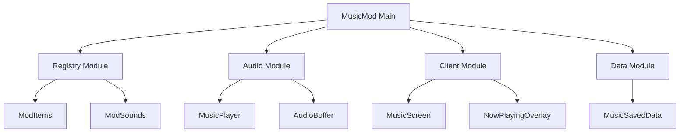

# Example: minecraft-docs-architect Output

This is an example of documentation generated by the `minecraft-docs-architect` agent for a hypothetical Minecraft mod.

---

# MusicMod Documentation

## 1. Overview

### 1.1 Mod Description
MusicMod is a Forge 1.20.1 mod that adds custom music playback functionality to Minecraft, featuring advanced audio controls, progress tracking, and custom advancement UI.

### 1.2 Features Summary
- Custom music disc items with long-form audio support
- OpenAL-based audio playback with seeking capabilities
- Custom advancement screen with progress visualization
- In-game music controls (play, pause, seek, volume)
- Progress persistence across sessions

### 1.3 Getting Started
```java
// Add dependency to your build.gradle
dependencies {
    implementation fg.deobf("com.example:musicmod:1.0.0")
}
```

### 1.4 Requirements
- Minecraft 1.20.1
- Forge 47.1.0+
- Java 17+

---

## 2. Architecture

### 2.1 Package Structure
```
com.example.musicmod/
├── MusicMod.java              # Main mod class, event bus registration
├── init/                      # Registration classes
│   ├── ModItems.java          # Music disc items
│   ├── ModSounds.java         # Sound event registrations
│   └── ModCreativeTabs.java   # Creative tab organization
├── audio/                     # Audio subsystem
│   ├── MusicPlayer.java       # OpenAL playback engine
│   ├── AudioBuffer.java       # Buffer management
│   └── StreamingSource.java   # Streaming audio source
├── client/                    # Client-only code
│   ├── screen/
│   │   └── MusicScreen.java   # Custom music UI
│   ├── overlay/
│   │   └── NowPlayingOverlay.java
│   └── handler/
│       └── ClientMusicHandler.java
├── data/                      # Data persistence
│   ├── MusicProgress.java     # Progress tracking
│   └── MusicSavedData.java    # World-level persistence
└── network/                   # Networking
    └── MusicPackets.java      # Client-server sync
```

### 2.2 Module Overview



### 2.3 Design Patterns Used
- **Singleton**: MusicPlayer service (single audio engine instance)
- **Observer**: Event-driven playback state notifications
- **Strategy**: Pluggable audio codecs
- **Builder**: Music disc item properties

### 2.4 Component Diagram
```
┌─────────────────────────────────────────────────────────────┐
│                        MusicMod                              │
├─────────────────────────────────────────────────────────────┤
│  ┌─────────────┐  ┌─────────────┐  ┌─────────────┐         │
│  │   Registry  │  │    Audio    │  │   Client    │         │
│  │   Module    │  │   Module    │  │   Module    │         │
│  │             │  │             │  │             │         │
│  │  ModItems   │  │ MusicPlayer │  │ MusicScreen │         │
│  │  ModSounds  │  │ AudioBuffer │  │  Overlays   │         │
│  └─────────────┘  └─────────────┘  └─────────────┘         │
│         │                │                │                 │
│         └────────────────┼────────────────┘                 │
│                          │                                  │
│                  ┌───────┴───────┐                         │
│                  │  Data Module  │                         │
│                  │               │                         │
│                  │ MusicSavedData│                         │
│                  │ MusicProgress │                         │
│                  └───────────────┘                         │
└─────────────────────────────────────────────────────────────┘
```

---

## 3. Registry Systems

### 3.1 Items

```java
// src/main/java/com/example/musicmod/init/ModItems.java
public class ModItems {
    public static final DeferredRegister<Item> ITEMS =
        DeferredRegister.create(ForgeRegistries.ITEMS, MusicMod.MODID);

    public static final RegistryObject<Item> CUSTOM_MUSIC_DISC =
        ITEMS.register("custom_music_disc",
            () -> new RecordItem(15, ModSounds.CUSTOM_TRACK,
                new Item.Properties().stacksTo(1).rarity(Rarity.RARE), 3600));

    public static void register(IEventBus modEventBus) {
        ITEMS.register(modEventBus);
    }
}
```

**Registered Items**:
| Item ID | Class | Description |
|---------|-------|-------------|
| `musicmod:custom_music_disc` | `RecordItem` | Custom music disc with 3600 tick duration |

### 3.2 Sound Events

```java
// src/main/java/com/example/musicmod/init/ModSounds.java
public class ModSounds {
    public static final DeferredRegister<SoundEvent> SOUNDS =
        DeferredRegister.create(ForgeRegistries.SOUND_EVENTS, MusicMod.MODID);

    public static final RegistryObject<SoundEvent> CUSTOM_TRACK =
        SOUNDS.register("custom_track",
            () -> SoundEvent.createVariableRangeEvent(
                new ResourceLocation(MusicMod.MODID, "custom_track")));
}
```

---

## 4. Event System

### 4.1 Event Handlers

```java
// src/main/java/com/example/musicmod/event/ModEvents.java
@Mod.EventBusSubscriber(modid = MusicMod.MODID, bus = Mod.EventBusSubscriber.Bus.FORGE)
public class ModEvents {

    @SubscribeEvent
    public static void onPlayerTick(TickEvent.PlayerTickEvent event) {
        if (event.phase == TickEvent.Phase.END) {
            // Update music progress
            MusicProgress.tick(event.player);
        }
    }

    @SubscribeEvent
    public static void onWorldLoad(LevelEvent.Load event) {
        if (!event.getLevel().isClientSide()) {
            // Initialize saved data
            MusicSavedData.get((ServerLevel) event.getLevel());
        }
    }
}
```

### 4.2 Tick Handlers
- **PlayerTickEvent**: Updates music progress (60 ticks/second)
- **ServerTickEvent**: Syncs progress to clients (20 ticks/second)

---

## 5. Data Persistence

### 5.1 NBT Serialization

```java
// src/main/java/com/example/musicmod/data/MusicProgress.java
public class MusicProgress {
    private static final String TAG_PROGRESS = "Progress";
    private static final String TAG_TRACK_ID = "TrackId";

    public CompoundTag save() {
        CompoundTag tag = new CompoundTag();
        tag.putInt(TAG_PROGRESS, this.progress);
        tag.putString(TAG_TRACK_ID, this.trackId);
        return tag;
    }

    public static MusicProgress load(CompoundTag tag) {
        MusicProgress progress = new MusicProgress();
        progress.progress = tag.getInt(TAG_PROGRESS);
        progress.trackId = tag.getString(TAG_TRACK_ID);
        return progress;
    }
}
```

### 5.2 SavedData

```java
// src/main/java/com/example/musicmod/data/MusicSavedData.java
public class MusicSavedData extends SavedData {
    private static final String DATA_NAME = MusicMod.MODID + "_music_data";

    public static MusicSavedData get(ServerLevel level) {
        return level.getDataStorage().computeIfAbsent(
            MusicSavedData::load,
            MusicSavedData::new,
            DATA_NAME
        );
    }
}
```

---

## 6. Client-Side

### 6.1 Custom Screen

```java
// src/main/java/com/example/musicmod/client/screen/MusicScreen.java
public class MusicScreen extends Screen {
    private static final ResourceLocation TEXTURE =
        new ResourceLocation(MusicMod.MODID, "textures/gui/music_screen.png");

    @Override
    public void render(GuiGraphics guiGraphics, int mouseX, int mouseY, float partialTick) {
        this.renderBackground(guiGraphics);
        guiGraphics.blit(TEXTURE, this.leftPos, this.topPos, 0, 0, 176, 166);
        super.render(guiGraphics, mouseX, mouseY, partialTick);
    }
}
```

### 6.2 Audio System

The mod uses OpenAL for advanced audio playback:

```java
// src/main/java/com/example/musicmod/audio/MusicPlayer.java
public class MusicPlayer {
    private int sourceId;
    private int[] bufferIds;

    public void play(ResourceLocation track) {
        // OpenAL setup and playback
        sourceId = AL10.alGenSources();
        // ... streaming implementation
    }

    public void seek(float position) {
        AL10.alSourcef(sourceId, AL11.AL_SEC_OFFSET, position);
    }
}
```

---

## 7. Resources

### 7.1 Sound Definition
```json
// src/main/resources/assets/musicmod/sounds.json
{
  "custom_track": {
    "sounds": [
      {
        "name": "musicmod:music/custom_track",
        "stream": true
      }
    ]
  }
}
```

### 7.2 Language File
```json
// src/main/resources/assets/musicmod/lang/en_us.json
{
  "item.musicmod.custom_music_disc": "Custom Music Disc",
  "item.musicmod.custom_music_disc.desc": "Custom Track - Artist Name"
}
```

---

## 8. API Reference

### 8.1 Public API

```java
// Access music player instance
MusicPlayer player = MusicPlayer.getInstance();

// Play a track
player.play(new ResourceLocation("musicmod", "custom_track"));

// Control playback
player.pause();
player.resume();
player.seek(0.5f); // Seek to 50%

// Check state
boolean isPlaying = player.isPlaying();
float progress = player.getProgress();
```

---

## 9. Performance

### 9.1 Optimization Strategies
- **Lazy Loading**: Audio buffers loaded on first use
- **Streaming**: Large audio files streamed, not fully loaded
- **Caching**: Progress lookups use O(1) HashMap

### 9.2 Best Practices
- Use `@OnlyIn(Dist.CLIENT)` for client-only audio code
- Avoid blocking main thread with audio operations
- Clean up OpenAL resources when mod unloads

---

*Generated by minecraft-docs-architect agent*
