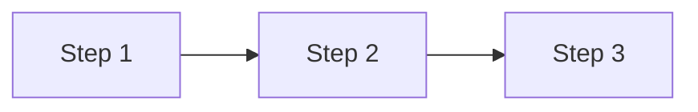
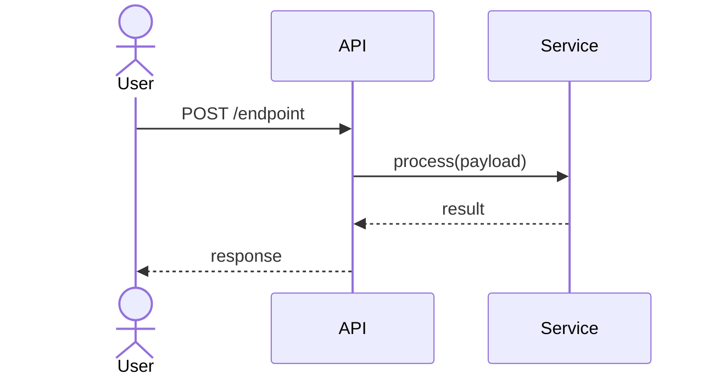
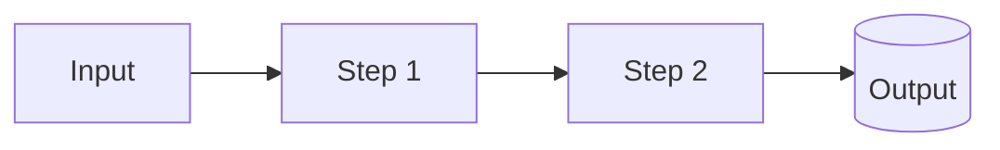
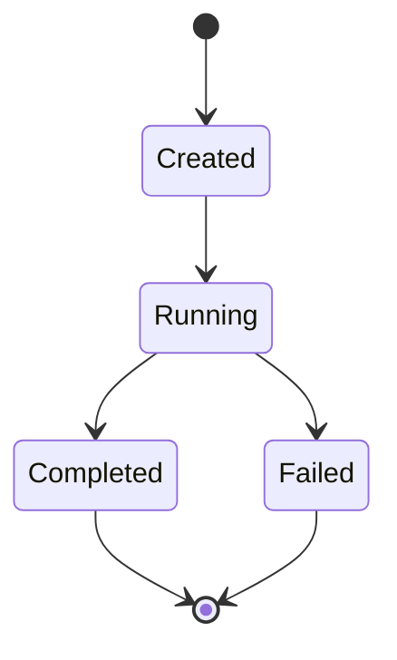
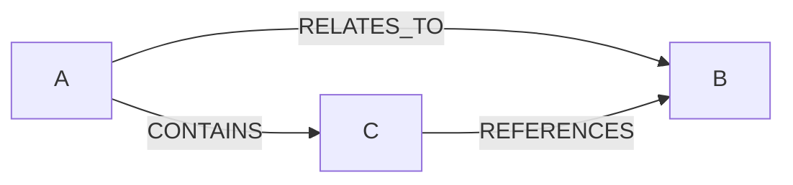
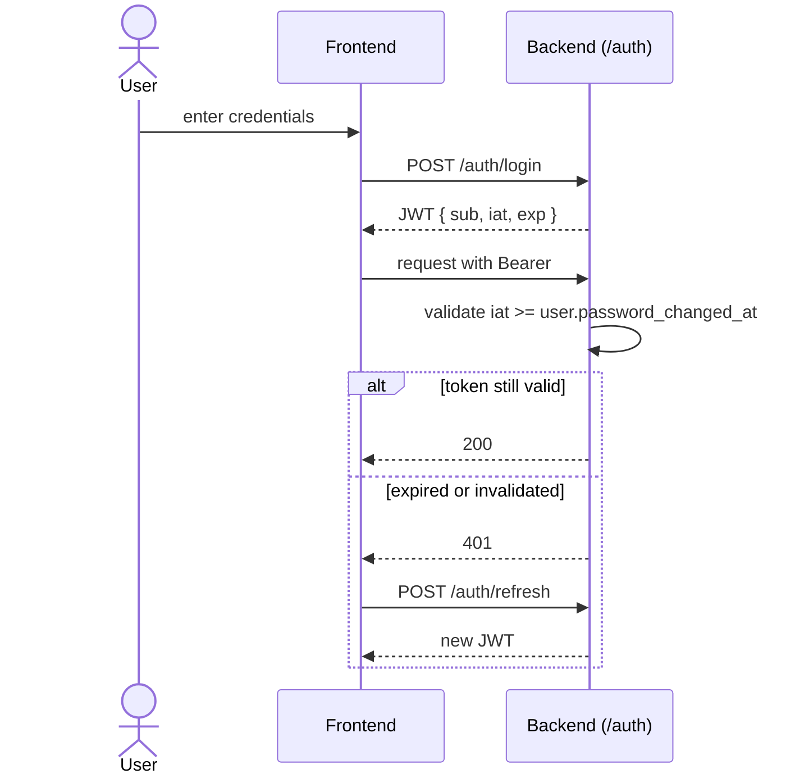

# Note Templates Reference

Drop-in contents for `_Templates/` and example shapes for each note type. Write
templates **first** — every subsequent note (yours or a subagent's) follows these
shapes.

## `_Templates/Concept Note.md`

```markdown
---
tags: [<zone>, <subzone>]
---

# <Concept Name>

> One-sentence summary of what this concept *is* (not what the code does).

## Source

- `path/to/file.ext` — primary implementation
- `path/to/related.ext` — supporting

## How it works

[1–3 short paragraphs, OR a Mermaid diagram, OR a numbered flow.]



## Depends on

- [[Other Concept]] — why this dep exists
- [[Integration]] — at integration level

## Used by

- [[Calling Concept]]

## Gotchas

- *(Drop this section if there are none.)*

## See also

- [[_index]] — parent MOC
- [[Related Concept]]
```

## `_Templates/Pattern Note.md`

```markdown
---
tags: [pattern]
---

# <Pattern Name>

> When to apply this pattern, in one sentence.

## When to apply

[Describe the trigger condition.]

## The pattern

```python
# Minimal example
```

## Why

[The reason this pattern exists — often a past incident or a non-obvious constraint.]

## Don't

- Don't do X — why
- Don't do Y — why

## See also

- [[_index]]
- [[Related Pattern]]
```

## `_Templates/Integration Note.md`

```markdown
---
tags: [integration]
---

# <Integration Name>

> What this external system does for us, in one sentence.

## Used for

- [[Use Case A]]
- [[Use Case B]]

## Configuration

- Env vars: `FOO_API_KEY`, `FOO_ENDPOINT`
- Config file: `path/to/config.ext`

## Wire-up

Where the integration is initialized in the codebase:

- `path/to/entrypoint.ext:LINE` — startup
- `path/to/usage.ext` — usage

## Auth mode

[API key / OAuth / subscription / etc.]

## Gotchas

- *(Drop this section if there are none.)*

## See also

- [[_index]]
- [[Related Integration]]
```

## `_index.md` (per-folder MOC) shape

Every leaf folder gets one of these. Group concepts under H2 headings; each entry is a
wikilink + one-line description.

```markdown
---
tags: [moc, <zone>]
---

# <Zone Name> — Map of Content

> One-sentence purpose of this zone.

## <Subgroup heading>

- [[Concept A]] — one-line description
- [[Concept B]] — one-line description

## <Another subgroup>

- [[Concept C]] — one-line description

## See also

- [[_HOME]]
- [[Related zone _index]]
```

## `_HOME.md` (root MOC) shape

```markdown
---
tags: [moc, home]
---

# <Project Name> — Knowledge Vault

A graph-linked tour of the <project> codebase. **Start with the architecture flows** to
build mental scaffolding, then drill into modules or patterns as needed.

> **<Project>** is [one-paragraph elevator pitch — stack, purpose, scale].

## 🧭 Start here — Architecture flows

- [[<Main Domain Flow A>]] — high-level
- [[<Main Domain Flow B>]]
- [[Auth Flow]]
- [[Background Service Startup]]
- …

## 🐍 Backend
- [[01-Backend/<module>/_index|<module>]] — purpose
- …

## ⚛️ Frontend
- [[02-Frontend/<module>/_index|<module>]] — purpose
- …

## 🔌 External Integrations
→ [[03-Integrations/_index|All integrations]]

## 🧩 Patterns
→ [[04-Patterns/_index|All patterns]]

## 🛠️ Operations
→ [[05-Operations/_index|All operations]]

## 📖 Glossary
→ [[06-Glossary/_index|Glossary]]

## 🎯 Reading paths

**New contributor:** [[<Main Domain Flow>]] → [[01-Backend/<module>/_index|<module>]] → [[<Key Pattern>]]

**Frontend developer:** [[<Frontend Pattern A>]] → [[<Frontend Pattern B>]] → [[02-Frontend/components/_index|components]]

**DevOps / SRE:** [[Background Service Startup]] → [[Build Commands]] → [[Release Workflow]]
```

Replace every `<placeholder>` with concrete names from Step 2b's canonical wikilink list.

## Mermaid diagram quick reference

Use `mermaid` fenced code blocks. Obsidian renders them natively — no plugin needed.

### Sequence (for request/response or call flows)



### Flowchart (for pipelines / state transitions)



### State diagram (for lifecycle)



### Graph (for entity relationships)



### Mermaid fence rule

Always use exactly `` ```mermaid `` (lowercase, no variants). Aliases like
`` ```mmd ``, `` ```mermaid-flow ``, or `` ```flowchart `` will silently fail to render
in Obsidian.

## Filled example (use this as a reference, not a template)

Subagents produce better output when shown a complete example. This is what a
well-formed concept note looks like end-to-end:

```markdown
---
tags: [backend, auth]
---

# JWT Auth Flow

> JWT with configurable expiry, transparent refresh, and `iat`-based bulk invalidation
> on password change.

## Source

- `backend/app/api/v1/auth.py` — login, refresh, change-password
- `backend/app/db/models/user.py` — `password_changed_at` field
- `frontend/src/api/client.ts` — 401 interceptor

## How it works



Token expiry comes from `AppSettings.access_token_expire_minutes`. `change-password`
updates `password_changed_at`, which invalidates every prior token via the `iat` check
on the next request.

## Depends on

- [[User Model]] — stores `password_changed_at`
- [[Auth Endpoints]]
- [[HTTP Client Interceptor]] (frontend)

## Used by

- Every authenticated endpoint via the `get_current_active_user` dependency

## Gotchas

- The `iat` invalidation is timestamp-based — ensure server clock is reliable.
- Debug mode (`settings.debug + allow_debug_auth_bypass`) bypasses auth via FastAPI
  `dependency_overrides`.

## See also

- [[_index]]
- [[Fernet Encryption]] — secrets at rest
```

Note the shape: ~180 words, one Mermaid diagram, wikilinks throughout, source file refs
without line numbers (line numbers rot), gotchas only when non-obvious.

## Atomic-note checklist

Every concept note should:

- [ ] Have frontmatter `tags: [...]` (used by `tags:` queries + tag pane)
- [ ] Open with a `> blockquote` one-sentence summary
- [ ] List source file paths in `## Source`
- [ ] Explain "how it works" in 1–3 paragraphs OR a Mermaid diagram
- [ ] Wikilink every concept reference (e.g., `[[MongoDB]]`, `[[Auth Flow]]`)
- [ ] List `## Depends on` and `## Used by` (drop if empty)
- [ ] End with `## See also` linking back to `[[_index]]` and 1–3 related concepts
- [ ] Stay between 50–200 words (templates and stubs may be shorter)
